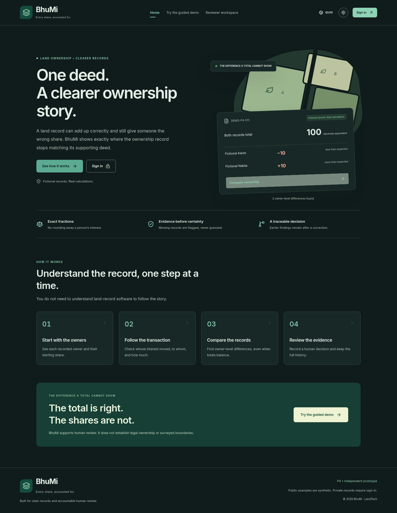

# BhuMi · ভূমি

**Land Ownership Reconciliation · LandTech 2026 · P4 — Smart e-Mutation & Registry**

A land record can add up correctly and still give someone the wrong share. BhuMi independently replays documented transfers, compares each owner's interest with the mutation record, and explains the difference for human review.

The rebuilt prototype includes a **Bangla/English guided demonstration**, **light/dark themes**, a private reviewer workspace, individual accounts and persistent PostgreSQL support for **one free Render web service**. All included records are fictional. BhuMi does not determine legal title, approve mutations or establish physical boundaries.



## Start here

| Your goal                            | Start with                                                    |
| ------------------------------------ | ------------------------------------------------------------- |
| Understand BhuMi without signing in  | [Public guided demonstration](#public-guided-demonstration)   |
| Run it on your computer              | [First-time local setup](#first-time-local-setup)             |
| Deploy on free Render                | [Free Render deployment guide](docs/deployment.md)            |
| Save findings and review corrections | [Reviewer walkthrough](#reviewer-walkthrough)                 |
| Create individual reviewer accounts  | [Team access and passwords](#team-access-and-passwords)       |
| Understand security and limits       | [Security architecture](docs/security.md)                     |
| Prepare the pitch                    | [Presentation and speaker notes](docs/presentation/README.md) |

**Upgrading from the original prototype?** The shared `REVIEWER_PASSWORD` and `SESSION_SECRET` login have been replaced. Configure `ADMIN_EMAIL`, `ADMIN_PASSWORD` and, on Render, `DATABASE_URL`. Existing embedded records are preserved when using the same local directory, but are not automatically moved to a hosted database. Follow the [upgrade instructions](docs/deployment.md#upgrading-an-existing-render-service) before redeploying.

## What changed

- An original public homepage that explains the problem before exposing technical controls.
- Five guided steps: starting owners → sale → mutation → difference → corrected example.
- Bangla and English navigation, forms, errors, explanations and report labels; a remembered language preference.
- Locally bundled Bengali/Latin fonts, localized numbers, and Bangla-digit input in the snapshot form.
- Light/dark themes, system preference by default, and a remembered manual choice.
- Individual accounts with salted password hashes, revocable server-side sessions and self-service password changes.
- Administrators assign specific parcels to each reviewer. Every private read/write checks authorization on the server.
- Protected reports and private, non-cacheable API responses. The public demo uses separate static fictional fixtures, never saved workspace data.
- Paginated parcel lists, run history, review queue, audit log and account lists.
- An external PostgreSQL adapter with a small connection pool, verified remote TLS and query timeouts. Local PGlite remains available for development.
- Validation of fractions, dates, identifiers, request sizes and review transitions; database constraints and transaction-based concurrency checks.
- Cold-start/error recovery that does not misreport account configuration when loading fails.

Planned, not implemented: public registration, email/password recovery, MFA, document uploads, new-parcel/event ingestion forms, automatic migration of old embedded data into hosted PostgreSQL, cross-parcel partition law, official government integration and legally validated inheritance rules. Source text and reviewer notes remain in the language in which they were entered; the application does not machine-translate evidence.

## What the terms mean

| Term               | Meaning                                                               |
| ------------------ | --------------------------------------------------------------------- |
| Parcel             | A land record identified by a reference such as `DEMO-P4-001`.        |
| Baseline           | The starting recorded ownership distribution, with source provenance. |
| Event              | A documented transfer or allocation that changes expected interests.  |
| Expected ownership | Interests reconstructed by replaying those events.                    |
| Mutation snapshot  | A separate observed record to compare with the reconstruction.        |
| Run                | A saved calculation containing its inputs and result.                 |
| Review case        | Human review of a saved run's findings.                               |

A share is a fraction **of the whole parcel**. On a 120-decimal parcel, `1/4` is equivalent to 30 decimals. “Decimal” here is a land-area unit—**শতক**—not a request to type decimal notation. An undivided share is not a surveyed physical boundary.

## Public guided demonstration

No account or working database connection is needed to use this demonstration after the frontend loads. It does not save changes.

1. Open the homepage. Bangla is the default language; choose **English** at the top to switch. The moon/sun control changes the theme.
2. Select **উদাহরণ দিয়ে বুঝুন / See how it works**.
3. Choose the 120-decimal example or the concept note's 100-decimal example.
4. **Starting owners:** inspect each person's initial share.
5. **The sale:** see whose interest moves to the buyer. The other co-owners should retain their shares.
6. **The mutation:** inspect the separately supplied recorded distribution.
7. **Find the difference:** inspect owner-level differences calculated by the actual exact-fraction engine.
8. **Check a correction:** choose **Use the corrected sample**. The engine recalculates and displays MATCH.
9. To save calculations or review actions, open **Reviewer workspace** and sign in.

For `DEMO-P4-001`, A sells 30 decimals equivalent to D. Expected areas are A 30, B 40, C 20, D 30; mutation shows A 30, B 25, C 20, D 45. B is short 15, D has 15 extra, and both totals equal 120.

For `DEMO-P4-011`, fictional Rahim sells 25 from his 60-decimal interest. Expected areas are 35, 40 and 25; mutation shows 35, 30 and 35. The hidden shift is 10 decimals, even though both totals equal 100.

## First-time local setup

Install [Git](https://git-scm.com/downloads) and [Node.js 24 LTS](https://nodejs.org/en/download), which includes npm. Verify with `git --version`, `node --version` and `npm --version`. Node should report `v24.*`.

```bash
git clone https://github.com/void-pronway/BhuMi-Land-Reconciliation.git
cd BhuMi-Land-Reconciliation
npm ci --include=dev
node scripts/local-credentials.mjs
npm run db:migrate
npm run db:seed
npm run dev
```

If you already have the repository, use that checkout. Run all commands from the folder containing `package.json`. No Docker, separate database server or external account is required for local development.

The credential helper creates or supplements an ignored `.env.local`, preserving existing values. Open it **privately in your editor** and read `ADMIN_EMAIL` and `ADMIN_PASSWORD`. The generated password is not printed. Do not share or commit this file.

When the terminal reports that the server is ready, open `http://localhost:3000`. Keep the terminal running. In a remote workspace, use its supplied access mechanism; your laptop's localhost is not the remote machine.

The migration/seed commands prepare eleven synthetic parcels and the first administrator account. They are repeatable and preserve existing data. The first backend request can also initialize a new database. A bootstrap account is created only once: changing `ADMIN_PASSWORD` later does **not** reset an existing account password.

### Local environment variables

| Variable                           | Purpose                                                                                    |
| ---------------------------------- | ------------------------------------------------------------------------------------------ |
| `DATABASE_PATH=.data/bhumi`        | Embedded PostgreSQL directory, used only when `DATABASE_URL` is empty and not on Render.   |
| `DATABASE_URL`                     | Optional hosted PostgreSQL connection URL; if set, it takes precedence over local storage. |
| `APP_ORIGIN=http://localhost:3000` | Exact allowed browser origin, without a trailing slash.                                    |
| `ADMIN_EMAIL`                      | Email address for the first administrator account.                                         |
| `ADMIN_PASSWORD`                   | Initial administrator password, 12–128 characters.                                         |
| `SEED_DEMO=true`                   | Load missing fictional fixtures. Set `false` for an intentionally empty database.          |

`.env.example` contains names and explanations, not usable credentials. The old shared-password variables are no longer used.

### Stop and restart

Press `Ctrl+C` to stop the server. Run `npm run dev` to restart it; signing out or restarting does not delete saved records. Only one process may use a local PGlite directory, so stop it before running migration/seed commands against that directory.

For a production-mode local run, stop development first:

```bash
npm run build
npm run start
```

To use another port, set `APP_ORIGIN=http://localhost:3005`, restart with `npm run dev -- --port 3005`, and use that exact browser address. For production use `npm run start -- --port 3005`.

## Reviewer walkthrough

### 1. Sign in

Open **পর্যালোচকের কর্মক্ষেত্র / Reviewer workspace**. Enter your individual email address and password. For your local administrator, use the private values from `.env.local`. On a hosted installation, your administrator provides your account privately.

There is no public registration or universal password. Reviewers only see assigned parcels; administrators can access all parcels and manage accounts. Sessions expire after eight hours. Sign-out, revocation and password changes invalidate server-side sessions.

### 2. Open a parcel and inspect its inputs

In **Assigned parcels**, open `DEMO-P4-001`. Lists have six records per page; use **Next page** for later examples. A reviewer with no grants sees an explanatory empty state.

Inspect **Starting ownership** and expand the **Documented events**. The sale transfers `1/4` of the whole parcel from A to D. Source identifiers remain unchanged in both languages so they stay traceable. Document text and reviewer notes are displayed in their original language.

Choose the original `SYN-MUTATION-001` under **Mutation snapshot**, especially if someone has already added a correction.

### 3. Save the comparison

Click **Run reconciliation**. The result shows B −15 and D +15, with both totals at 120. Expand calculation details to see rule codes and event/source IDs.

**Mutation snapshot** selects the input for your next calculation. **Previous calculations** opens an already-saved result. Changing the input does not calculate or rewrite anything until you run the engine.

Each run is saved independently; rerunning the original snapshot is permitted and creates another run. This differs from duplicate event processing: one event is never applied twice within a valid replay.

### 4. Open and act on a case

Under the result, enter a **Reason for opening this review**, such as `Compare the co-owner allocation with the deed.`, then click **Create review case**. A run can have one case; repeated creation does not duplicate it.

Open **Review queue**. For the new case:

1. Choose **Under review**, write `Checked the deed and prior co-owner record.`, then **Record review action**.
2. Choose **Needs evidence**, write `Request a corrected mutation allocation.`, and save again.
3. Open **Activity history** to inspect the actor, action and reason.

Notes must contain at least five characters after trimming. Only valid next actions are offered. If someone updates the same case while you are editing, the server rejects your stale version and asks you to refresh rather than overwriting their decision.

### 5. Append a corrected snapshot

Return to **Assigned parcels**, reopen `DEMO-P4-001`, and select **Add a revised snapshot**.

| Field   | Enter | Equivalent area |
| ------- | ----- | --------------: |
| Owner A | `1/4` |              30 |
| Owner B | `1/3` |              40 |
| Owner C | `1/6` |              20 |
| Buyer D | `1/4` |              30 |
| Buyer E | `0`   |               0 |

Bangla digits such as `১/৩` are also accepted by this form. Do not enter `30` to mean 30 decimals: a share field is a fraction of the whole parcel. Percent notation and decimal notation such as `25%` or `0.25` are not supported. Negative shares, zero denominators, shares above one, duplicate parties and unknown parties are rejected.

Select an effective date on or after the baseline and supplied events; `2026-04-01` works for this example. Enter an **Evidence / reason** note, then **Save new snapshot**. If a newer snapshot was saved concurrently, refresh and inspect it before trying again.

The system retains the old snapshot. Deliberately unequal aggregate mutation totals can still be recorded for comparison: the engine must be able to report incorrect observed records, rather than silently “repairing” them. Each individual share must still be valid.

### 6. Reconcile again and resolve the case

The new snapshot is selected automatically. Click **Run reconciliation** and expect MATCH. Open the earlier result under **Previous calculations** to verify that its conflict remains.

Go to **Review queue**. From **Needs evidence**, first record **Under review**, then **Resolved**, each with a meaningful note. Resolution changes case status, not the old calculation. A resolved case can be reopened.

### 7. Print the report

From a saved result, choose **Open printable report**. The protected report opens in another tab and offers a language switch and **Print / save PDF**. It contains the run's captured calculation, source documents, event transformations, current review outcome and recent case audit entries.

The report remains accessible only to authorized users, even if someone shares its URL. Keep any exported PDF within the authorized review process.

## Team access and passwords

An administrator can open **Team access**, enter the reviewer's name, email, a unique initial password of at least 12 characters, and comma-separated parcel IDs such as `DEMO-P4-001, DEMO-P4-002`. Only those parcels become accessible. Existing grants cannot be edited through this prototype UI; revoke an account if its access is no longer appropriate.

Share the initial password privately. The reviewer should open **My account → Change password** after first sign-in. A password change signs out all sessions; sign in again with the new password. **Revoke access** disables an account and invalidates its sessions immediately for subsequent requests. The interface cannot revoke the administrator's own account.

Email-based recovery and MFA are not implemented. Protect your administrator access and database provider account. Do not put passwords into review notes or public issue reports.

## Understand outcomes

| Outcome               | Meaning                                                                                 |
| --------------------- | --------------------------------------------------------------------------------------- |
| MATCH                 | Supplied interests reconcile under the supported assumptions; not legal-title approval. |
| CONFLICT              | A specific owner allocation or record-linkage discrepancy was found.                    |
| INSUFFICIENT_EVIDENCE | Required sources or ordering links are missing or ambiguous.                            |
| REVIEW_REQUIRED       | Replay could not safely complete, or a source requires interpretation/verification.     |

Evidence completeness is separate from authenticity. “Sources supplied” does not mean legally verified. A discrepancy is not automatically a fraud allegation. A stopped replay may display a partial state; do not treat it as a final expected allocation.

## Try all eleven scenarios

The following outcomes refer to the original seeded inputs:

| Parcel      | Example                               | Outcome               |
| ----------- | ------------------------------------- | --------------------- |
| DEMO-P4-001 | Hidden co-owner loss, 120 decimals    | CONFLICT              |
| DEMO-P4-002 | Clean partial sale                    | MATCH                 |
| DEMO-P4-003 | Sale with no mutation supplied        | INSUFFICIENT_EVIDENCE |
| DEMO-P4-004 | Excessive transfer                    | REVIEW_REQUIRED       |
| DEMO-P4-005 | Wrong mutation recipient              | CONFLICT              |
| DEMO-P4-006 | Repeated transaction reference        | CONFLICT              |
| DEMO-P4-007 | Missing succession prerequisite       | INSUFFICIENT_EVIDENCE |
| DEMO-P4-008 | Out-of-order dependency               | INSUFFICIENT_EVIDENCE |
| DEMO-P4-009 | Exact fractional transfers            | MATCH                 |
| DEMO-P4-010 | Documented reallocating correction    | MATCH                 |
| DEMO-P4-011 | Hidden 10-decimal shift, 100 decimals | CONFLICT              |

## Troubleshooting

| Symptom                                       | Next step                                                                                                                                                                          |
| --------------------------------------------- | ---------------------------------------------------------------------------------------------------------------------------------------------------------------------------------- |
| Build cannot find `@tailwindcss/postcss`      | Use `npm ci --include=dev && npm run build`. Build tools are needed even with `NODE_ENV=production`.                                                                               |
| Hosted workspace cannot load                  | Check `DATABASE_URL`, provider connectivity, Render runtime logs and `/api/health`. Free instances may need time to wake up. The public demo still works after the frontend loads. |
| Old shared password no longer works           | Use the new administrator email/password or an assigned individual account. See the upgrade guide.                                                                                 |
| Invalid-origin message                        | Set `APP_ORIGIN` to the exact browser origin, including HTTPS and custom domain, without a trailing slash; restart.                                                                |
| No assigned parcels                           | Ask the administrator for parcel access; use the public demo while waiting.                                                                                                        |
| A password changed but old access still fails | Bootstrap variables create an account once. Change an existing password through **My account**; changing the environment variable is not a password reset.                         |
| Stale review/snapshot error                   | Refresh, inspect the newer record, then resubmit a deliberate change.                                                                                                              |
| Latest result still shows an old conflict     | Save the revised snapshot, select it, and run a new comparison. Select that new run under Previous calculations.                                                                   |
| Local database locked                         | Stop the other process using that directory. Do not delete records as the first troubleshooting step.                                                                              |
| Want a fresh local practice dataset           | Stop the app, use a new `DATABASE_PATH` such as `.data/practice-02`, seed and restart. Keep the old directory to return to it.                                                     |
| New account not visible in the list           | Use account pagination; lists show ten items per page.                                                                                                                             |
| Login throttled                               | Wait for the account's 15-minute attempt window. Global login throttling uses a one-minute window.                                                                                 |

## Developer verification

```bash
npm test
npm run typecheck
npm run lint
npm run build
npx playwright install chromium
npm run test:e2e
npm run test:restart
```

Browser tests use port 3001 and dedicated embedded data directories, synthetic credentials and a fresh administrator. Restart tests use port 3002. They override ordinary database settings for isolation. **Only set `TEST_DATABASE_URL` to a disposable test database**: it is the explicit opt-in for testing the external adapter and will receive synthetic fixtures and test accounts. Never use a real or shared database for it.

If system Chromium is available on Linux, use `PLAYWRIGHT_CHROMIUM_EXECUTABLE_PATH=/usr/bin/chromium npm run test:e2e`. In PowerShell, set `$env:PLAYWRIGHT_CHROMIUM_EXECUTABLE_PATH` to the actual executable path, then run the test command.

The CI workflow includes PostgreSQL 17 and tests both adapters. Remote CI completion is not inferred from local success. Tests update screenshots in `docs/screenshots/`; temporary traces stay in ignored `test-results/`.

See [measured validation](docs/validation.md), [architecture](docs/architecture.md), and [security boundaries](docs/security.md).

## Responsible use and project ownership

Use fictional or explicitly authorized records only. No genuine NIDs, portal scraping, live government integration, document upload service or external AI ownership decisions are included. Free hosting does not establish legal suitability for real sensitive records. Backups, recovery, institutional policy, independent security review and domain validation remain prerequisites for such use.

The concept note and master development prompt were inspected. The official rulebook, strategy report and official logo were not supplied. The inspiration site's live domain remained inaccessible from the development environment after retry; the redesign is original and makes no claims about that site's implementation.

Institutional background, not proof of legal completeness:

- [State Acquisition and Tenancy Act, 1950, section 89](https://bdlaws.minlaw.gov.bd/act-241/section-7068.html).
- [World Bank, Bangladesh Land Acquisition Diagnostic Review (2022)](https://documents1.worldbank.org/curated/en/099359509012228968/pdf/IDU05ea6dbd70b70e04c7f0b5ef06fbc25ad4670.pdf).

**AI assistance:** OpenAI ChatGPT (GPT-6) and Codex assisted with planning, code, tests and documentation. Student developers must understand, review and demonstrate the work. Ownership results come from deterministic rules, not AI judgments. Bangla wording should receive a fluent domain expert's review before institutional use.

Team lead: [Name, DIU ID] · Student developer: [Name, DIU ID] · Faculty mentor: [Name, Department] · Industry mentor: [Name, Organisation].

Dependencies include Next.js, React, TypeScript, Tailwind, Lucide, Zod, Drizzle, node-postgres, PGlite, Inter, Noto Sans Bengali, Vitest, Playwright and Prettier. Their respective upstream licenses apply. No project license has been selected on the team's behalf.

## Changelog

- **Rebuild:** bilingual guided UX, light/dark themes, private reviewer access, scoped accounts, durable PostgreSQL adapter, pagination, concurrency guards, improved validation and deployment instructions.
- **Initial prototype:** exact engine, eleven synthetic fixtures, review cases, printable reports and demonstration deck.
