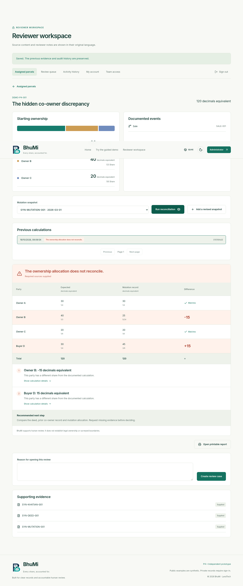
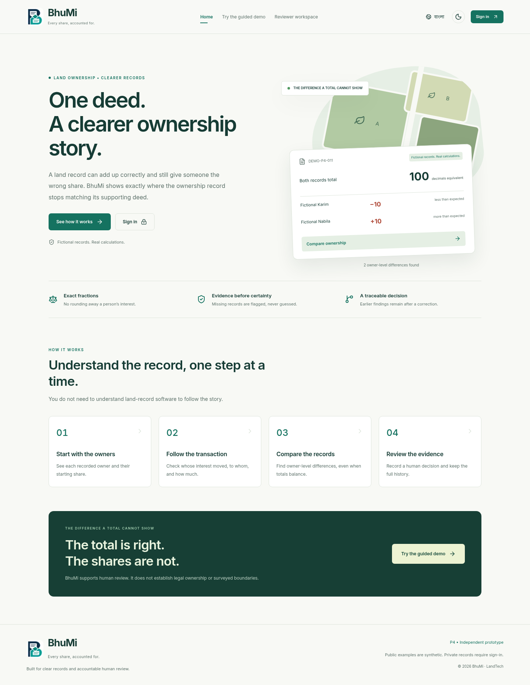

# BhuMi · Land Ownership Reconciliation Engine

**LandTech Innovation Hackathon 2026 · P4 — Smart e-Mutation & Registry**

A registered deed and the mutation that follows can tell different ownership stories. BhuMi reconstructs documented ownership interests using exact fractions, compares each party with the supplied mutation, and gives a simulated reviewer source-linked findings. **Correct total area does not necessarily mean correct ownership allocation.**

This is an independent, synthetic-data prototype, not a government service or a legal-title verification system. Undivided share equivalents do not establish physical boundaries.

**First visit?** Start with the [beginner guide](#start-here), then follow the complete [hands-on walkthrough](#guided-walkthrough-detect-review-and-correct-a-discrepancy).

## What works

- BigInt rational arithmetic, deterministic event replay and exact owner-by-owner comparison.
- Sales, gifts, explicit succession allocations, same-parcel partitions and documented reallocating corrections. No automatic inheritance-law decisions.
- Nine discrepancy categories, separate evidence completeness, four reconciliation outcomes.
- Eleven seeded scenarios, including the 120-decimal signature case and concept note’s 100-decimal example.
- Searchable parcel explorer, baseline distribution, expandable event history and source evidence.
- Persistent reconciliation runs, revised mutation snapshots, review cases and audit history.
- Password-protected simulated reviewer actions; read-only public demonstration.
- Printable source-linked reports; responsive desktop/mobile interface.

Planned, **not implemented**: hosted PostgreSQL adapter, institution-managed identities, bilingual UX, document/event ingestion editor, cross-parcel partition and legal-rule templates, official integrations. OCR, blockchain and AI ownership decisions are intentionally outside the prototype.

## Architecture

```text
Next.js / React workspace
   → Zod-validated, authorized route handlers
   → pure TypeScript reconciliation engine
   → Drizzle parameterized SQL + embedded PostgreSQL (PGlite)
   → historical runs, review cases, audit entries and printable reports
```

The baseline, ownership events and observed mutation snapshots remain separate. A mutation never becomes an ownership event. Runs capture their complete input and result; a revised snapshot creates a new calculation without changing earlier findings. Review decisions never rewrite ownership inputs.

See [architecture and rules](docs/architecture.md) and [demo guide](docs/demo.md).

## Start here

**New to the prototype?** Follow [first-time setup](#first-time-setup), then the [guided walkthrough](#guided-walkthrough-detect-review-and-correct-a-discrepancy). You do not need to understand the source code to use the demo.

**Already running in a prepared environment?** Open its existing application session and go to [reviewer sign-in](#sign-in-as-a-simulated-reviewer). Do not start a second server against the same database.

Useful sections:

- [What the terms mean](#what-the-terms-mean)
- [Find your way around](#find-your-way-around)
- [Understand the results](#understand-the-results)
- [Try the other scenarios](#try-the-other-scenarios)
- [Stop, restart and repeat the demo](#stop-restart-and-repeat-the-demo)
- [Troubleshooting](#troubleshooting)
- [Developer checks](#developer-checks)

## What the terms mean

| Term                          | Meaning in this prototype                                                         |
| ----------------------------- | --------------------------------------------------------------------------------- |
| Parcel                        | One fictional land record, identified by a reference such as `DEMO-P4-001`.       |
| Baseline / starting ownership | The recorded distribution before the transactions being checked.                  |
| Ownership event               | A documented change, such as a sale from one owner to another.                    |
| Expected ownership            | The shares calculated by replaying the documented events from the baseline.       |
| Mutation snapshot             | A separate supplied record of ownership, which may disagree with the calculation. |
| Reconciliation run            | A saved comparison of expected ownership with a chosen mutation snapshot.         |
| Finding / discrepancy         | An explained difference or evidence problem identified by a run.                  |
| Review case                   | A human-review workflow attached to a run's findings.                             |

Shares are fractions **of the entire parcel**. For a 120-decimal parcel, `1/4` means an undivided interest equivalent to 30 decimals. Here, “decimal” is a land-area unit, not an instruction to enter a decimal number. These equivalents do not identify a physically surveyed piece of land.

## First-time setup

### 1. Install the prerequisites

You need [Git](https://git-scm.com/downloads), [Node.js **24 LTS**](https://nodejs.org/en/download) and **npm** (included with Node.js). A code editor such as VS Code is useful for opening configuration files. Check your installation in a terminal:

```bash
git --version
node --version
npm --version
```

`node --version` should begin with `v24.`. If a command is not recognized, install the missing tool and reopen your terminal. Docker, a separate PostgreSQL installation, Supabase and API keys are **not required**: the local database runs inside the application using PGlite.

### 2. Get the project and install dependencies

For a new local checkout:

```bash
git clone https://github.com/void-pronway/BhuMi-Land-Reconciliation.git
cd BhuMi-Land-Reconciliation
npm ci
```

If the repository is already present, open a terminal in that folder and run `npm ci`; do not clone a second copy unnecessarily. All subsequent commands in this guide run from the folder containing `package.json`.

### 3. Create your private reviewer configuration

```bash
node scripts/local-credentials.mjs
```

The helper creates `.env.local` in the project root, containing a randomly generated reviewer password, a session-signing secret and the local database path. Its success message begins **“Created private .env.local.”** It does not print the password.

Open `.env.local` in your editor. You will use the value after `REVIEWER_PASSWORD=` to sign in later. Keep this file private; it is excluded from Git.

If the helper says **“.env.local exists; preserved without changes,”** it has not replaced any settings. Check that the existing file contains a nonempty `REVIEWER_PASSWORD` and a `SESSION_SECRET` of at least 32 characters. Merely copying `.env.example` leaves these credentials empty and does not enable reviewer access.

### 4. Prepare the sample records

With the application stopped, run:

```bash
npm run db:migrate
npm run db:seed
```

Expect a message saying **“11 synthetic parcels available. Existing records preserved.”** These commands create the schema and missing sample parcels. Running them again does not reset your work or duplicate existing parcels.

### 5. Start the application

```bash
npm run dev
```

Keep that terminal open. When the server reports that it is ready, open `http://localhost:3000` in your browser. The first request may take a little longer while the application initializes.

On a fresh database, the overview shows **11 fictional parcels**, **0 reconciliation runs** and **0 open review cases**. That is expected: the sample records are loaded, but no comparisons have been saved yet. If someone has already used this database, the run and case counts will be higher.

For a remote cloud workspace, use the access mechanism supplied by that workspace. `localhost` in your laptop's browser refers to your laptop, not the cloud machine. The administrator must configure `APP_ORIGIN` to match the exact browser origin used for reviewer actions.

## Sign in as a simulated reviewer

1. Click **Reviewer sign in** at the top right.
2. In your editor, find `REVIEWER_PASSWORD` in `.env.local`.
3. Copy only its value into the password field—not the variable name or the `=` sign.
4. Click **Sign in**. The sidebar should now identify you as **Review officer**, and the top bar should offer **Sign out**.

There is no username, account-registration form or built-in universal password. This prototype uses one locally configured simulated reviewer identity. If someone else hosts the demo, ask that administrator for access through an appropriate private channel; do not share the entire configuration file.

| Public visitor                                                | Signed-in reviewer                            |
| ------------------------------------------------------------- | --------------------------------------------- |
| Browse synthetic parcels, supplied evidence and saved results | All public functions, plus run reconciliation |
| Read existing cases and reports                               | Create cases and record review actions        |
| Cannot change records                                         | Append revised synthetic mutation snapshots   |

Signing out does not delete saved work. A session expires after approximately eight hours; sign in again if an action requires authorization.

## Find your way around

| Screen / control              | What to use it for                                                                                                                                                    |
| ----------------------------- | --------------------------------------------------------------------------------------------------------------------------------------------------------------------- |
| **Overview**                  | See counts for this synthetic database and open the featured example with **Explore the discrepancy**. Counts describe saved runs and cases, not national statistics. |
| **Parcel explorer**           | Search by parcel reference, title or mouza; click a parcel card to inspect it.                                                                                        |
| **Reconciliation**            | Select a parcel, inspect starting ownership and events, choose a mutation snapshot, then run the comparison.                                                          |
| **Review queue**              | Open existing findings, record notes and workflow actions, and inspect the audit trail.                                                                               |
| **Printable evidence report** | Open a saved run's sources, comparison and review history in a separate tab.                                                                                          |

There are two different selectors in the reconciliation workspace:

- **Mutation snapshot** chooses the input for your **next** run. Changing it does not recalculate anything until you click **Run reconciliation**.
- **Historical run** chooses a result that was **already saved**. It does not change the source records or rerun the engine.

## Guided walkthrough: detect, review and correct a discrepancy

Allow about 10–15 minutes for your first walkthrough. Use only the fictional values below.

### Step 1 — Open the signature parcel

From **Overview**, click **Explore the discrepancy**. Alternatively, search for `DEMO-P4-001` in **Parcel explorer**.

Check that **Selected parcel** is `DEMO-P4-001` and the recorded area is **120 decimals**. The **Starting ownership** panel shows:

| Party   | Starting share | Equivalent area |
| ------- | -------------- | --------------: |
| Owner A | `1/2`          |              60 |
| Owner B | `1/3`          |              40 |
| Owner C | `1/6`          |              20 |

### Step 2 — Read the transaction and supplied mutation

Expand **sale · SALE-001** in **Documented events**. Owner A transfers `1/4` of the whole parcel—30 decimals equivalent—to Buyer D. Owner B and Owner C do not participate.

In **Mutation snapshot**, choose the original **SYN-MUTATION-001**. This matters if someone has already added a corrected snapshot. Expand **Inspect supplied mutation** to see the recorded shares before running the comparison. The **Source evidence** cards below describe the fictional baseline, deed and mutation documents.

### Step 3 — Run the comparison

Click **Run reconciliation**. The result should be **Conflict**, with this calculated comparison:

| Party     | Expected area equivalent | Mutation area equivalent | Mutation minus expected |
| --------- | -----------------------: | -----------------------: | ----------------------: |
| Owner A   |                       30 |                       30 |                       0 |
| Owner B   |                       40 |                       25 |                     −15 |
| Owner C   |                       20 |                       20 |                       0 |
| Buyer D   |                       30 |                       45 |                     +15 |
| **Total** |                  **120** |                  **120** |                   **0** |

Read the two **MUTATION_WRONG_SHARE** findings below the table. They identify Owner B's missing interest and Buyer D's excess interest, together with event/source references and a recommended review step. Both totals balance; the owner-by-owner allocation does not.

After a run, expanding the sale also shows the reconstructed before-and-after states. A source marked **Supplied** is a provided demo record, not a legally verified document.



### Step 4 — Create a review case and request evidence

1. Click **Create review case** below the result. It changes to **Review case created**.
2. Open **Review queue** in the sidebar. Find the case for `DEMO-P4-001`; its status starts as **New**. If there are several cases, inspect their original findings to identify the one you just created.
3. Under **Next action**, choose **under review**. Enter this example **Reviewer note**: `Compared the sale deed with the prior co-owner record.`
4. Click **Record review action**. Confirm the status is **Under review**.
5. Choose **needs evidence**, enter `Request a corrected fictional mutation allocation for Owner B and Buyer D.`, and click **Record review action** again.
6. Check the **Audit trail** below the cases. It records the actions and reasons.

Notes must contain at least five characters after surrounding whitespace is trimmed. The menu only offers valid next actions: a new case must enter **Under review** before it can be resolved. A reviewer can request evidence or escalate a case when a decision is not yet supported.

### Step 5 — Add a corrected snapshot

Click the case's `DEMO-P4-001` parcel link to return to reconciliation, then click **Append revised snapshot**.

Enter these **fractions**, not area values or percentages:

| Form field | Enter | Meaning on this parcel                                          |
| ---------- | ----- | --------------------------------------------------------------- |
| Owner A    | `1/4` | 30 decimals equivalent                                          |
| Owner B    | `1/3` | 40 decimals equivalent                                          |
| Owner C    | `1/6` | 20 decimals equivalent                                          |
| Buyer D    | `1/4` | 30 decimals equivalent                                          |
| Buyer E    | `0`   | No interest; this extra fictional party is not part of the sale |

Use the **Evidence / reason** note: `New synthetic mutation allocation matches the supplied sale deed and prior co-owner record.` Then click **Save new snapshot**.

Supported inputs include `1/3`, `0` and `1`. Do not enter `30`, `25%` or `0.25` to mean a quarter share: `30` means thirty whole-parcel shares, and percentage/decimal notation is not supported. Negative shares and zero denominators such as `1/0` are invalid.

This action appends a new fictional observation and an evidence note. It does not edit the original mutation or upload a document. The current demo assigns appended snapshots a fixed effective date of **2026-04-01**; date editing is not implemented.

### Step 6 — Verify the correction and preserve the history

The newly saved snapshot is selected automatically and has a reference beginning **SYN-AMENDMENT-**. Click **Run reconciliation** again.

Expect **Match** and the message **“The supplied ownership records reconcile.”** All owner differences should now be zero. If the old conflict is still displayed immediately after saving, that is expected until you run the new calculation.

Use **Historical run** to select the earlier **CONFLICT** result. The original −15/+15 findings remain. Select the new **MATCH** run to return to the corrected comparison. The correction does not erase the original case or automatically resolve it.

### Step 7 — Resolve the review case with a note

Return to **Review queue**. For the case left in **Needs evidence**:

1. Choose **under review**, enter a note saying the revised snapshot was received, and save the action.
2. Choose **resolved**, enter `The new reconciliation run matches the supplied records; the earlier finding is retained for audit.`, and save again.
3. Confirm the case reads **Resolved** and the audit trail contains both actions.

Resolving the case records the reviewer's decision. It does not change the old run from CONFLICT to MATCH. A resolved case can be reopened by returning it to **Under review**.

### Step 8 — Open or print the evidence report

Return to the parcel, choose the desired **Historical run**, and click **Printable evidence report**. In the new tab, click **Print / Save as PDF**, then choose your browser's print or PDF destination.

The report shows the selected run's calculation, captured sources and event sequence, together with its current review outcome and audit history. To demonstrate traceability, open the original conflicting run's report after resolving its case: the finding should still be visible.

**Walkthrough complete:** you have detected an error, recorded human review, verified a corrected record, and retained the original evidence.

## Understand the results

| Outcome                   | Meaning                                                                              | Suggested next step                                                                         |
| ------------------------- | ------------------------------------------------------------------------------------ | ------------------------------------------------------------------------------------------- |
| **MATCH**                 | The supplied records reconcile under the supported assumptions.                      | Inspect the sources and retain the report. This is not legal-title approval.                |
| **CONFLICT**              | The engine found a specific inconsistency.                                           | Read the owner differences and source references; open a review case.                       |
| **INSUFFICIENT_EVIDENCE** | A baseline, source, dependency or other required connection is missing or ambiguous. | Supply or clarify evidence before relying on a calculated allocation.                       |
| **REVIEW_REQUIRED**       | The replay could not safely complete, or evidence needs interpretation/verification. | Inspect the finding and seek human review; do not treat a partial state as final ownership. |

Evidence status is separate from the calculation outcome. **Complete supplied** means the required references were supplied for this calculation; it does not certify their legal authenticity. A discrepancy is not automatically a fraud allegation.

## Try the other scenarios

Open **Parcel explorer**, search for a reference, and run reconciliation as a reviewer. The outcomes below apply to the **original seeded snapshot**, before any revised inputs are added.

| Parcel        | What it demonstrates                                               | Expected outcome                                |
| ------------- | ------------------------------------------------------------------ | ----------------------------------------------- |
| `DEMO-P4-001` | Hidden co-owner loss despite equal totals                          | CONFLICT                                        |
| `DEMO-P4-002` | Clean partial sale                                                 | MATCH                                           |
| `DEMO-P4-003` | Registered sale with no mutation supplied                          | INSUFFICIENT_EVIDENCE; missing-mutation finding |
| `DEMO-P4-004` | Transfer larger than the sender's interest                         | REVIEW_REQUIRED; over-transfer finding          |
| `DEMO-P4-005` | Mutation gives interest to the wrong recipient                     | CONFLICT                                        |
| `DEMO-P4-006` | Mutation references a transaction twice                            | CONFLICT                                        |
| `DEMO-P4-007` | Missing prerequisite succession evidence                           | INSUFFICIENT_EVIDENCE                           |
| `DEMO-P4-008` | Transfer depends on a later event                                  | INSUFFICIENT_EVIDENCE                           |
| `DEMO-P4-009` | Exact thirds, sixths and twelfths                                  | MATCH                                           |
| `DEMO-P4-010` | Explicit correction event retained in replay history               | MATCH                                           |
| `DEMO-P4-011` | Concept note's 100-decimal example, with a hidden 10-decimal shift | CONFLICT                                        |

## Stop, restart and repeat the demo

- **Stop:** press `Ctrl+C` in the terminal running the application.
- **Restart development:** from the project folder, run `npm run dev` again. You do not need to reinstall or reseed each time.
- **Keep your work:** runs, snapshots, cases and audit entries persist in `.data/bhumi` by default. Signing out, refreshing the browser and restarting the application do not remove them.
- **Repeat the original example:** choose **SYN-MUTATION-001** in **Mutation snapshot**, then run again. This creates another historical run; it does not reset previous work.
- **Revisit a result without creating another run:** use **Historical run**.

Only one process may own a PGlite data directory. Stop the app before running migration/seed commands against that directory, and do not launch development and production servers against it simultaneously.

For a fresh practice dataset without deleting your existing work, stop the app, change `DATABASE_PATH` in `.env.local` to a new unused path such as `.data/practice-02`, run the migration/seed commands, and start the app again. To return to your previous records, stop the app and restore the original path. Keep `.env.local` private throughout.

### Run a production build locally

Stop the development server first:

```bash
npm run build
npm run start
```

Open the same browser origin. Rebuild after source changes when using production mode. This local persistence adapter is not suitable for ephemeral/serverless deployment; connecting a hosted database requires an implemented adapter and migration process, not just a Supabase URL.

## Deploy manually on Render

Create a **Node Web Service** connected to this repository's `main` branch. Use a paid service with a persistent disk and one instance for the embedded database.

| Setting                    | Value                                   |
| -------------------------- | --------------------------------------- |
| Root directory             | Leave empty                             |
| Build command              | `npm ci --include=dev && npm run build` |
| Start command              | `npm run start -- --port $PORT`         |
| Auto-deploy                | Off for manual deployments              |
| Persistent disk mount path | `/var/data`                             |
| Health check path          | `/api/workspace`                        |

**Keep `--include=dev` in the build command.** When `NODE_ENV=production`, a plain `npm ci` omits development dependencies. Next.js still needs Tailwind's PostCSS plugin and TypeScript during the build. Omitting them causes errors such as `Cannot find module '@tailwindcss/postcss'`. Including build tools does not change the application to development mode: `next build` and `next start` still produce and serve a production application.

Configure these variables in Render's Environment settings:

| Variable            | Value                                                              |
| ------------------- | ------------------------------------------------------------------ |
| `NODE_VERSION`      | `24.19.0`                                                          |
| `NODE_ENV`          | `production`                                                       |
| `DATABASE_PATH`     | `/var/data/bhumi`                                                  |
| `REVIEWER_PASSWORD` | Your strong, private reviewer password                             |
| `SESSION_SECRET`    | A random secret of at least 32 characters                          |
| `APP_ORIGIN`        | The exact assigned HTTPS service address, without a trailing slash |

Do not upload `.env.local`. The persistent disk is available at runtime, not during the build, so do not add migration or seed commands to Render's build command. The first application request initializes the database and missing synthetic records automatically.

For an existing failed deployment, change **Settings → Build Command** to the value above, save it, then choose **Manual Deploy → Deploy latest commit**. Keep `NODE_ENV=production`. A “No build cache found” warning does not cause the missing-module error.

After deployment, open the service, sign in, run `DEMO-P4-001` and create a review case. Restart the service and confirm that both the run and case remain. This validates the persistent-disk configuration. Local build verification does not establish that a Render deployment has succeeded.

## Troubleshooting

| Symptom                                                   | What to check or do                                                                                                                                                                                 |
| --------------------------------------------------------- | --------------------------------------------------------------------------------------------------------------------------------------------------------------------------------------------------- |
| `node`, `npm` or `git` is not recognized                  | Install the missing prerequisite, reopen the terminal, and check its version. Use Node 24.                                                                                                          |
| npm cannot find `package.json`                            | Change into the `BhuMi-Land-Reconciliation` folder before running project commands.                                                                                                                 |
| Dependency installation fails                             | Check network access and Node version. Retry `npm ci` after fixing the reported cause. For a restricted cloud machine whose default cache is unwritable, use `npm ci --cache /tmp/bhumi-npm`.       |
| `.env.local` is not visible                               | Show hidden files or open the project root in your editor. Run the credentials helper if the file does not exist.                                                                                   |
| “Reviewer access is not configured” or incorrect password | Check the existing `.env.local`: password must be nonempty and session secret at least 32 characters. The helper preserves existing files. Restart after configuration changes, then sign in again. |
| **Run reconciliation** or review buttons are disabled     | Sign in as a reviewer. A MATCH run has no findings to open a case for; an existing case also disables duplicate case creation for that run.                                                         |
| Invalid origin / authorization error after signing in     | Use the exact configured browser origin. `localhost` and `127.0.0.1` differ; so do HTTP/HTTPS and port numbers. Check `APP_ORIGIN`, restart, and sign in again.                                     |
| Port 3000 is already occupied                             | Stop the other server if it is yours, or choose another port and update `APP_ORIGIN` as shown below. Do not leave the old and new processes using the same database.                                |
| Database is locked or cannot open                         | Stop other processes using that data directory. Check that `DATABASE_PATH` is writable. Do not delete the database as a first troubleshooting step.                                                 |
| The “corrected” comparison still shows a conflict         | Check the selected snapshot, verify the fractions in the walkthrough, click **Run reconciliation**, and choose the latest run. Saving a snapshot alone does not calculate a new result.             |
| Cannot resolve a case                                     | A case must be **Under review** first. From **Needs evidence**, record an **under review** action, then a **resolved** action, each with a note.                                                    |
| Reseeding did not restore the original dashboard counts   | Seeding preserves existing work. Select the original snapshot or use a separate practice database instead of expecting a reset.                                                                     |
| Print report does not open                                | Allow the new browser tab. Choose a saved run first; reports belong to runs.                                                                                                                        |
| Browser tests cannot find Chromium                        | Run `npx playwright install chromium`, or configure an existing Chromium executable as described below.                                                                                             |

For example, to use port **3005**, add this line to `.env.local`:

```dotenv
APP_ORIGIN=http://localhost:3005
```

Then start the app with `npm run dev -- --port 3005` and open `http://localhost:3005`. For production mode use `npm run start -- --port 3005`. Restart after changing environment settings. Use HTTPS and an explicitly configured origin for remotely accessed instances.

## Developer checks

You do not need to run these checks just to try the prototype. They are useful when changing code or preparing a submission. From the project folder:

```bash
npm test
npm run typecheck
npm run lint
npm run build
npx playwright install chromium
npm run test:e2e
npm run test:restart
```

Stop your development server before building. Browser tests require the production build and free port **3001**; the restart check uses port **3002**. Avoid exporting your demo `DATABASE_PATH` into the test terminal: the browser-test configuration preserves an already exported value. With no such override, tests use separate `.data/e2e-*` and `.data/restart-*` directories and do not reset the main demo database.

If Chromium is already installed, skip its download. On Linux, with Chromium at the example path:

```bash
PLAYWRIGHT_CHROMIUM_EXECUTABLE_PATH=/usr/bin/chromium npm run test:e2e
```

For PowerShell, set the actual executable path before running the command:

```powershell
$env:PLAYWRIGHT_CHROMIUM_EXECUTABLE_PATH = 'C:\path\to\chrome.exe'
npm run test:e2e
```

Failure traces and temporary screenshots are stored under ignored `test-results/`. Browser tests also refresh the tracked demonstration screenshots in `docs/screenshots/`; inspect those changes before committing.

[Measured validation results](docs/validation.md) distinguish executed checks from limitations. Tests prove behavior on synthetic inputs, not effectiveness on real national records. For a short presentation after completing the walkthrough, see the [90-second recording script and finalist demo guide](docs/demo.md).

## Screenshots

These are captures of the actual application: [dashboard](docs/screenshots/dashboard.png), [reconciliation](docs/screenshots/reconciliation.png), and [mobile](docs/screenshots/mobile-dashboard.png). An original temporary wordmark is included; the official logo was not supplied.



## Security and privacy

Only fictional records are seeded. No genuine NIDs, private records, portal scraping, speculative government APIs or external accounts are used. Server-side reviewer checks, strict-origin checks, signed HttpOnly session cookies, parameterized queries, input validation and database transactions protect the prototype workflow. Login throttling is process-local and intentionally simple.

This is a single-instance demo with one shared reviewer identity, not production IAM. Public reads include synthetic evidence and audit information; real personal data would require per-record authorization and redaction. Database administrators can alter stored data: append-only application behavior is not a tamper-proof guarantee. Do not expose real data or claim legal certification.

## Sources and project ownership

Inspected: the supplied **BhuMi Concept Note** and **Master Development Prompt**. Not supplied: official rulebook, strategy report, competitor concept note, official logo. Compliance claims from those missing sources have not been independently checked. Original implementation; no competitor code, layout or branding copied.

Institutional context (not proof of legal completeness):

- [Bangladesh State Acquisition and Tenancy Act, 1950, section 89](https://bdlaws.minlaw.gov.bd/act-241/section-7068.html).
- [World Bank, Bangladesh Land Acquisition Diagnostic Review (2022)](https://documents1.worldbank.org/curated/en/099359509012228968/pdf/IDU05ea6dbd70b70e04c7f0b5ef06fbc25ad4670.pdf).
- The supplied concept note additionally cites Daily Sun (18 August 2025), Bangladesh Post (4 October 2024), and BSS (24 November 2025). Their claims were not independently reverified during implementation.

**AI assistance disclosure:** OpenAI ChatGPT (GPT-6) and Codex assisted with architecture, implementation, tests and documentation. Student developers must review, understand and demonstrate the submitted work. Ownership outcomes are deterministic rules, not AI judgments.

Team lead: [Name, DIU ID] · Student developer: [Name, DIU ID] · Faculty mentor: [Name, Department] · Industry mentor: [Name, Organisation].

Dependencies include Next.js, React, TypeScript, Tailwind CSS, Lucide, Zod, Drizzle ORM, PGlite, Vitest, Playwright and Prettier; their respective upstream licenses apply. No project license has been selected on the team’s behalf.

## Changelog

- Initial working prototype: exact engine, eleven synthetic fixtures, persistent reviewer workflow, report, automated tests and demo documentation.
- Post–Round 1 improvements: to be recorded by the team after submission; none claimed yet.
