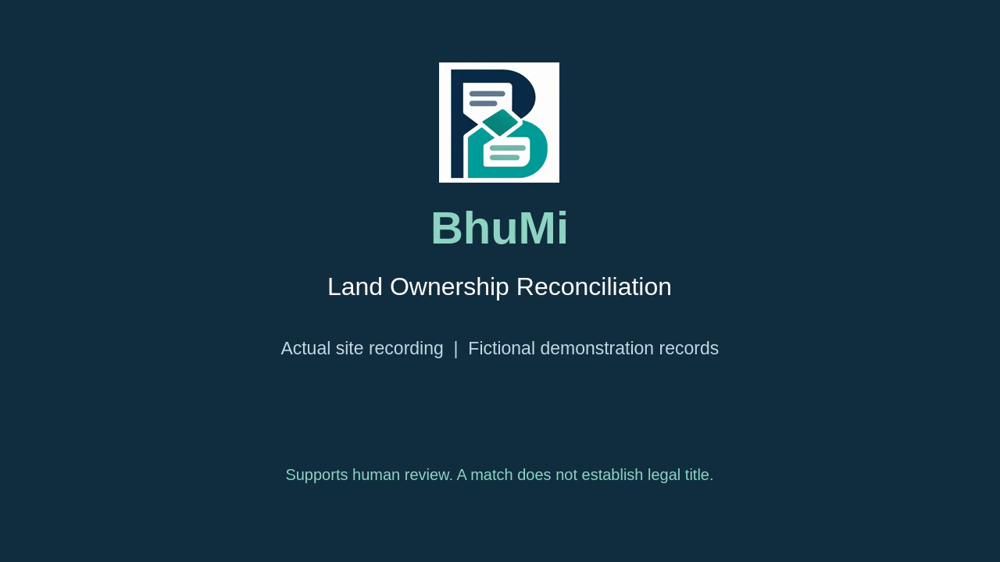

# Edited BhuMi demonstration

[](BhuMi_Demo_60s.mp4)

- [Download the 60-second MP4](BhuMi_Demo_60s.mp4)
- [English subtitle/description file](BhuMi_Demo_60s.en.srt)

The project owner supplied `2026-10-19 17-03-12.mp4`, an approximately 26-second recording of the actual Bangla site. This edit preserves the full walkthrough, removes browser chrome, slows it to a 50-second content segment, and adds five-second opening and closing cards with the supplied BhuMi logo. English explanations are burned into the lower caption band; the Bangla interface remains visible. There is no narration or music; the original audio contained silence.

Output: 1280×720, 30 fps, H.264/AAC MP4 with fast-start metadata, exactly 60 seconds, approximately 2 MB. All displayed records are fictional. The video demonstrates interface behavior; it is not independent verification of deployment availability or legal correctness. The website itself was not changed for this export.

## Edit timeline

| Time            | Content                                   |
| --------------- | ----------------------------------------- |
| 00:00–00:05     | BhuMi title and prototype context         |
| 00:05–00:12.6   | Bangla homepage                           |
| 00:12.6–00:20.2 | Ownership and mutation steps              |
| 00:20.2–00:27.8 | Discrepancy comparison                    |
| 00:27.8–00:39.2 | Corrected sample and matching result      |
| 00:39.2–00:55   | Judge workspace and fictional parcel list |
| 00:55–01:00     | Site address and judge-demo invitation    |

## Re-render

Keep the uploaded original unchanged. To reproduce the export:

```bash
python3 scripts/render-demo.py '/path/to/2026-10-19 17-03-12.mp4'
```

Requires Python 3, FFmpeg/FFprobe with libx264 and drawtext, and Liberation Sans fonts. The script reads the project logo from `public/brand` and writes the MP4 and SRT here. Its timing and browser crop are specific to the supplied recording. Change the script when using different footage. The original source remains in the upload attachment rather than being duplicated in Git.
